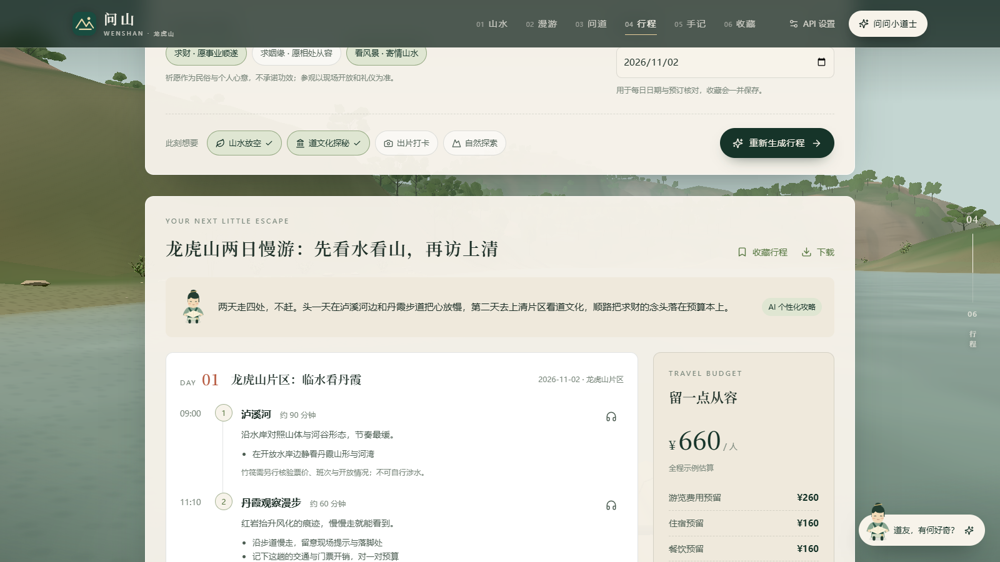

# 问山 · 龙虎山

沿江乘筏、走近宫观，与小道士聊山水。React + TypeScript + Three.js + Node/Express 构建的龙虎山主题网站。



## 当前版本

2026-10-09 公开源码，基于已完成的 CD + CE 版本：

- 四站串行游览：泸溪河 → 正一观 → 嗣汉天师府 → 大上清宫；滚动和点击统一驱动竹筏变速到站。
- 大地图内三宫观外部及已制作的内部自由探索；鼠标环视、键盘移动与触屏操作，能返回竹筏与首页。
- 分层雾气、动态流水、沿岸展示环境；大上清宫北端悬空屋盖补齐现代柱、梁及支撑。
- 小道士多轮对话、真实流式响应、取消与重试，默认接入 DeepSeek，支持保留自定义提供方。
- AI 个性化攻略：1–3 天、200–3000 元预算、旅行兴趣、节奏及求财／姻缘／看风景心愿。AI 编排每日固定真实片区内的景点、次序、停留和具体活动，服务端校验并计算时间；可收藏、下载。
- 关联携程龙虎山票务查询及鹰潭住宿。商品、日期、价格在携程再次确认，没有订单、支付或实时库存接入。
- 照片共创：上传 JPG/PNG/WebP，AI 提供分享文案和创意参数，浏览器合成 1080×1440 海报与 720×960、12 秒无声照片动效短片；支持编辑、复制、下载与取消。

[当前功能实机录像](docs/demo/ce-walkthrough.mp4) · [部署详细说明](docs/部署说明.txt)

## 本地启动

需要 Node.js **22.12 或更高**及 npm，推荐 Node 24 LTS。首次安装需要联网。

```bash
git clone https://github.com/chengweiliangz/wenshan-longhushan.git
cd wenshan-longhushan
npm ci
npm run dev
```

打开 <http://127.0.0.1:5173>。前端和 API 在同一端口，不需要 Blender。生产运行：

```bash
npm run check
npm start
```

生产默认 <http://127.0.0.1:4173>。`npm run check` 运行测试、TypeScript 检查并生成 `dist/`。生成文件不提交到源码仓库。

Windows 如需将所有安装缓存留在 E 盘，在项目终端先设置：

```powershell
New-Item -ItemType Directory -Force E:\Wenshan-cache\npm,E:\Wenshan-cache\tmp
$env:TEMP='E:\Wenshan-cache\tmp'
$env:TMP=$env:TEMP
$env:npm_config_cache='E:\Wenshan-cache\npm'
```

## 配置 AI

仓库不含真实密钥。未配置或禁用 AI 时，页面明确使用本地资料、规则或模板。

本机可打开右上角 **API 设置**，填写自己的服务信息、测试并保存；设置只存于服务器的 `.local/`。也可复制 `.env.example` 为 `.env` 后填写 `AI_API_KEY`，然后启动：

```dotenv
AI_ENABLED=true
AI_NAME=DeepSeek
AI_FORMAT=chat-completions
AI_BASE_URL=https://api.deepseek.com
AI_MODEL=deepseek-flash
AI_API_KEY=
```

`AI_API_KEY` 必须由使用者私下填写，不使用 `VITE_*` 变量，不提交 `.env` 或 `.local/`。已保存的有效 `.local` 配置优先于环境变量。公开部署由管理员在服务器或托管平台配置密钥，公网不能调用本机设置接口。

## 远程部署

本仓库是源码，不是已上线网址。完整功能需要 Node 服务，**不能仅把前端放到 GitHub Pages**。

- **Render Web Service**：连接本仓库，Node 24，构建 `npm ci && npm run build`，启动 `npm start`，健康路径 `/api/health`；设置 `HOST=0.0.0.0`，使用平台注入的 `PORT`。仓库包含 `render.yaml`。
- **Linux + Docker/Caddy**：源码多阶段 Dockerfile 会构建前端。复制 `.env.production.example` 为 `.env`，填实际域名及可选服务端密钥；`docker compose -p wenshan up -d --build`。需要域名解析及 80/443 入站。

分步操作、AI 配置、SSE、验收与更新方法见 [部署详细说明](docs/部署说明.txt)。没有替你创建云端实例或公开网址。

## 真实性与能力边界

- 三宫观沿岸展示位置及部分内部经过艺术化设计，真实地理资料另存；不是导航、测绘或完整实景复原。
- 行程时间与费用是规划估计，不代表实时开放、交通或票价；祈愿不承诺功效。
- 原照片留在浏览器，模型只接收文字、所选地点和尺寸／类型元信息，不识别照片内容。海报与短片是 AI 创意编排 + 原照片合成，不是扩散转绘或生成式视频模型。
- 收藏保存在当前浏览器；没有用户账户跨设备同步。
- 部分真实资料或精细地形仍有缺口；按各资产来源说明区分实拍、估算和艺术化内容。

## 验证

CE 版本通过 234 项测试、类型检查和生产构建。桌面与 Chrome 手机尺寸模拟已完成真实 DeepSeek 攻略、照片共创、收藏、下载、视频播放、取消与更换照片检查；手机模拟不等于实体手机实测。短片录制目标 24fps，实际帧率取决于设备和同时运行的三维场景。

当前公开副本另做依赖安装、测试和构建；没有把本地接口验证当成云端上线。旧开发机路径已从公开来源元数据中省略，外部来源链接保留。

## 目录

```text
src/          页面、三维场景和交互
server/       API、模型转发、路线编排与校验
shared/       资料、地点资产登记、人物提示词和共创契约
public/       运行所需模型、图片、字体、地形及来源记录
tests/        自动化测试
docs/         部署说明、演示及历史技术记录
```

## 素材来源与权利说明

资料来源见 `shared/catalog.mjs`、`shared/place-assets.mjs`、各资产的 `.sources.json` 和网页“资料与说明”。Noto Serif SC 保留原 OFL 许可。第三方照片、地图和参考材料按各自来源与授权条件使用；本仓库公开展示不代表所有素材采用统一开源许可。没有为整站额外指定开源许可证。

[UNESCO 中国丹霞](https://whc.unesco.org/en/list/1335/) · [UNESCO 龙虎山世界地质公园](https://www.unesco.org/en/iggp/longhushan-unesco-global-geopark)
